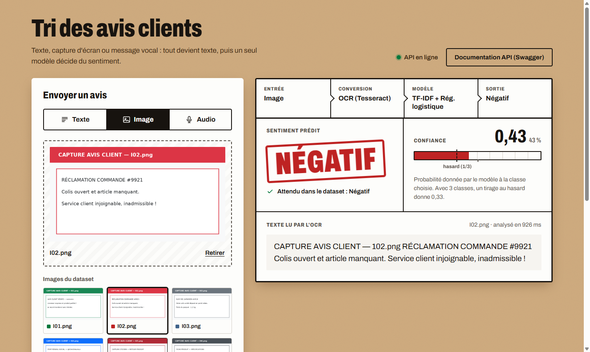
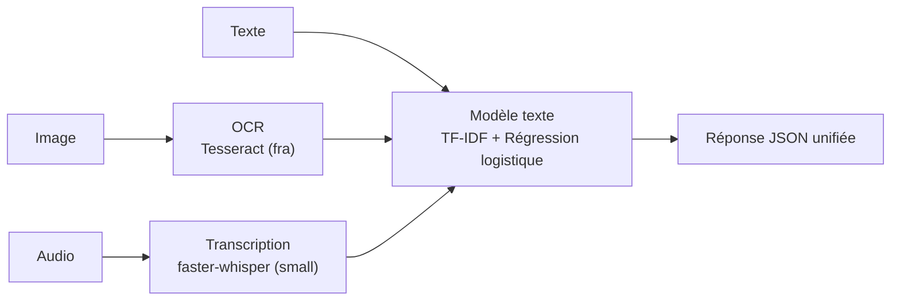
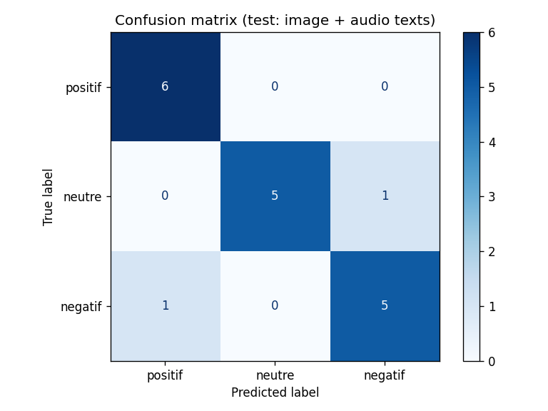
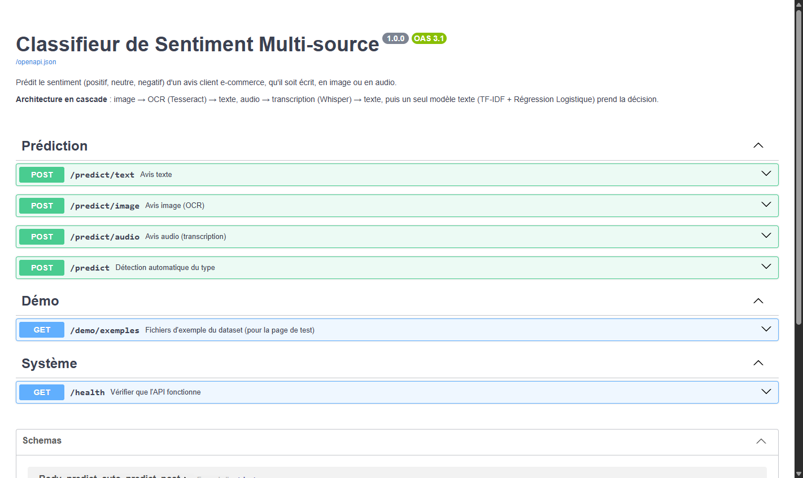
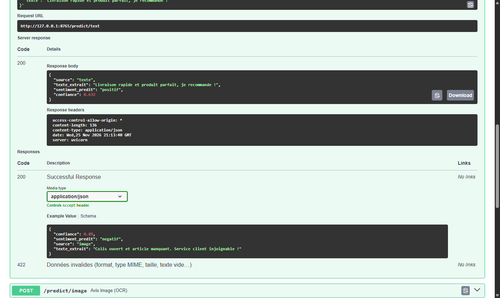
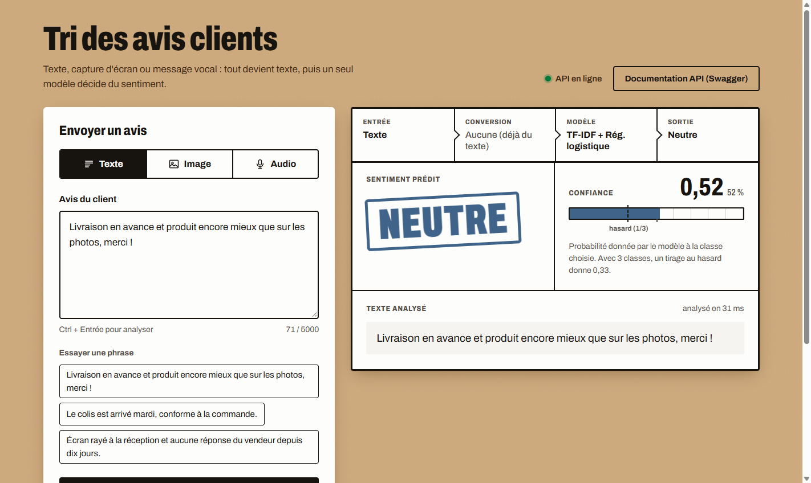
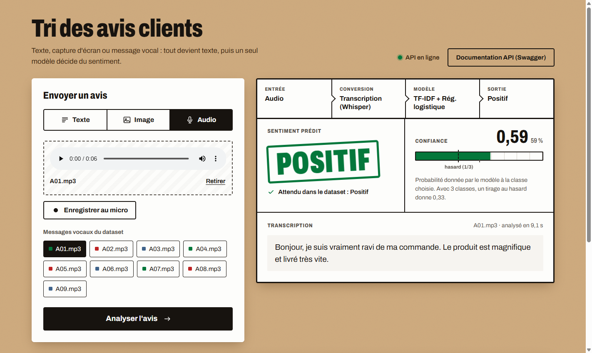
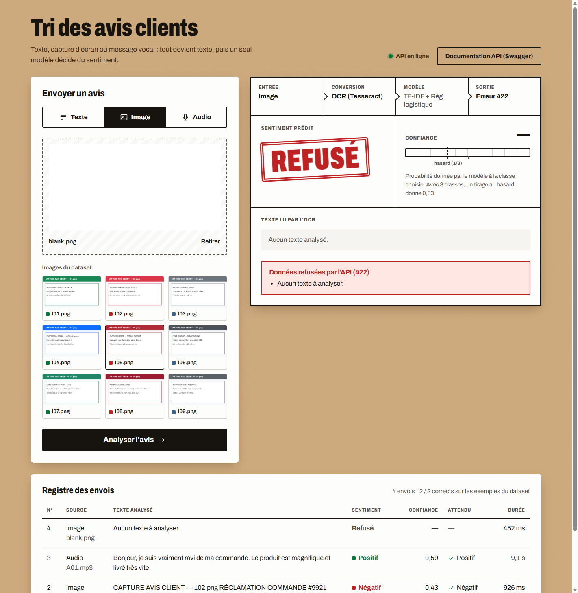

# Classifieur de Sentiment Multi-source

**Mini-projet ML Appliqué 2026 — « E-commerce Customer Voice »**

Un système unique qui prédit le sentiment d'un avis client (`positif`, `neutre` ou `negatif`), que l'avis soit **écrit**, en **image** (capture d'écran, ticket scanné) ou en **audio** (message vocal). Les prédictions sont exposées par une **API REST FastAPI** et testables depuis une **page web**.



---

## Sommaire

1. [Architecture en cascade](#1-architecture-en-cascade)
2. [Résultats](#2-résultats)
3. [Installation](#3-installation)
4. [Utilisation](#4-utilisation)
5. [API REST](#5-api-rest)
6. [Application web de test](#6-application-web-de-test)
7. [Tests automatisés](#7-tests-automatisés)
8. [Choix techniques, étape par étape](#8-choix-techniques-étape-par-étape)
9. [Limites et pistes d'amélioration](#9-limites-et-pistes-damélioration)
10. [Structure du projet](#10-structure-du-projet)

---

## 1. Architecture en cascade

L'idée clé : **tout devient du texte**, puis **un seul modèle texte** prend la décision. On n'entraîne donc qu'un modèle, et les trois sources partagent la même logique et la même réponse JSON.



Chaque route renvoie exactement la même structure :

```json
{
  "source": "image",
  "texte_extrait": "RÉCLAMATION COMMANDE #9921 Colis ouvert et article manquant. Service client injoignable, inadmissible !",
  "sentiment_predit": "negatif",
  "confiance": 0.43
}
```

`confiance` est la probabilité donnée par le modèle à la classe choisie (entre 0 et 1).

---

## 2. Résultats

### Modèle texte (étape 1)

Entraîné sur les **24 avis** de `textes.csv`, évalué sur **18 textes jamais vus** (les textes de référence de `images.csv` et `audios.csv`) :

| Classe | Précision | Rappel | F1 |
|---|---|---|---|
| positif | 0,86 | 1,00 | 0,92 |
| neutre | 1,00 | 0,83 | 0,91 |
| negatif | 0,83 | 0,83 | 0,83 |
| **Exactitude globale** | | | **0,89** |



### Cascade complète sur les fichiers du dataset (étape 2)

| Source | Sentiment correct | Qualité du texte extrait* |
|---|---|---|
| Image (OCR) | **8 / 9** | 86 % |
| Audio (transcription) | **8 / 9** | 99 % |

\* Similarité entre le texte extrait et le texte de référence. Pour les images, elle est plus basse car l'OCR lit aussi le bandeau de titre (« CAPTURE AVIS CLIENT — I01.png »), absent du texte de référence.

Les deux erreurs (`I09.png` et `A05.mp3`) viennent du **modèle texte**, pas de l'OCR ni de la transcription : le texte extrait est correct, et le modèle fait la même erreur sur le texte de référence. Le maillon faible est donc la petite taille du jeu d'entraînement (voir [Limites](#9-limites-et-pistes-damélioration)).

Détail par fichier : [`reports/pipelines_results.csv`](reports/pipelines_results.csv).

---

## 3. Installation

**Prérequis :** Python 3.10+ et Windows, Linux ou macOS.

### 3.1 Dépendances Python

```bash
python -m venv .venv
# Windows :  .venv\Scripts\activate
# Linux/Mac : source .venv/bin/activate
pip install -r requirements.txt
```

### 3.2 Tesseract OCR (programme externe)

| Système | Commande |
|---|---|
| Windows | `winget install --id UB-Mannheim.TesseractOCR` |
| Ubuntu / Debian | `sudo apt install tesseract-ocr` |
| macOS | `brew install tesseract` |

- Le fichier de langue **français** (`fra.traineddata`) est déjà fourni dans le dossier `tessdata/` du projet : rien d'autre à installer, et pas besoin des droits administrateur.
- Sur Windows, le code trouve Tesseract dans `C:\Program Files\Tesseract-OCR\` même s'il n'est pas dans le `PATH`. Pour un autre emplacement, définir la variable d'environnement `TESSERACT_CMD`.

### 3.3 Modèle Whisper

Le modèle `small` de faster-whisper (~460 Mo) est **téléchargé automatiquement** au premier lancement, puis gardé en cache. Pour un modèle plus léger : `WHISPER_MODEL=base` (ou `tiny`).

---

## 4. Utilisation

```bash
# 1. (Optionnel) Ré-entraîner le modèle -> models/*.pkl + reports/
python train.py

# 2. (Optionnel) Évaluer la cascade sur toutes les images et tous les audios -> reports/pipelines_results.csv
python evaluate_pipelines.py

# 3. Lancer l'API et la page de test
uvicorn main:app --reload
```

Puis ouvrir :

| Adresse | Contenu |
|---|---|
| http://127.0.0.1:8000/ | **Application web de test** |
| http://127.0.0.1:8000/docs | Documentation interactive **Swagger** |
| http://127.0.0.1:8000/redoc | Documentation **ReDoc** |

Les modèles `.pkl` sont fournis : l'étape 1 n'est pas obligatoire pour lancer l'API.

---

## 5. API REST

| Méthode | Route | Entrée | Description |
|---|---|---|---|
| POST | `/predict/text` | JSON `{"texte": "..."}` | Classe un avis écrit |
| POST | `/predict/image` | multipart, champ `fichier` | OCR puis classification |
| POST | `/predict/audio` | multipart, champ `fichier` | Transcription puis classification |
| POST | `/predict` | formulaire : `texte` **ou** `fichier` | Détecte le type automatiquement |
| GET | `/health` | — | Vérifie que l'API répond |

### Exemples avec curl

```bash
curl -X POST http://127.0.0.1:8000/predict/text \
     -H "Content-Type: application/json" \
     -d '{"texte": "Livraison rapide et produit parfait, je recommande !"}'

curl -X POST http://127.0.0.1:8000/predict/image -F "fichier=@dataset_sentiment_ecommerce/images/I02.png"

curl -X POST http://127.0.0.1:8000/predict/audio -F "fichier=@dataset_sentiment_ecommerce/audios/A01.mp3"

curl -X POST http://127.0.0.1:8000/predict -F "fichier=@dataset_sentiment_ecommerce/images/I05.png"
```

> Sous Git Bash (Windows), les accents dans `-d '...'` peuvent être mal encodés. Dans ce cas, mettre le JSON dans un fichier UTF-8 et utiliser `--data-binary @fichier.json`.

### Validation des entrées (Pydantic)

| Contrôle | Règle |
|---|---|
| Texte | 1 à 5 000 caractères après suppression des espaces, aucun champ inconnu |
| Format réel du fichier | Détecté à partir des **premiers octets** du fichier (« magic bytes »), pas du nom ni du `Content-Type` envoyé par le client |
| Images acceptées | PNG, JPEG, WEBP, BMP, TIFF — **5 Mo max** — image vérifiée avec Pillow |
| Audios acceptés | WAV, MP3, OGG, FLAC, WEBM, M4A — **10 Mo max** |
| Cohérence | Une image envoyée sur `/predict/audio` (ou l'inverse) est refusée |

Toute entrée invalide renvoie **422 Unprocessable Entity**, toujours au même format :

```json
{
  "detail": [
    {"type": "invalid_file", "loc": ["body", "fichier"], "msg": "Fichier image attendu, mais le fichier reçu est de type audio/mpeg."}
  ]
}
```

Cas couverts : champ manquant, texte vide, fichier vide, format non supporté, fichier trop volumineux, image corrompue, audio illisible, **image sans texte**, **audio silencieux**, et `texte` + `fichier` envoyés ensemble sur `/predict`.





---

## 6. Application web de test

J'ai choisi l'**option B** : une page **HTML/CSS/JavaScript statique**, servie directement par FastAPI à l'adresse `/`. Elle ne demande aucune dépendance supplémentaire et se lance avec la même commande que l'API.

Fonctionnalités :

- **Trois onglets** : Texte, Image, Audio.
- **Image** : glisser-déposer, sélection de fichier, ou **coller une capture d'écran** (Ctrl + V).
- **Audio** : fichier, ou **enregistrement au micro** depuis le navigateur.
- **Exemples du dataset en un clic**, avec le sentiment attendu : la page indique si la prédiction est correcte (✓ / ✗).
- **Chemin de la cascade** visible : Entrée → Conversion (OCR, transcription ou aucune) → Modèle → Sortie.
- **Indicateur de confiance** avec un repère « hasard (1/3) » : avec 3 classes, un tirage au hasard donne 0,33.
- **Texte extrait** affiché (ce qu'a lu l'OCR ou ce qu'a entendu Whisper).
- **Erreurs 422** affichées avec le message de l'API.
- **Registre des envois** : historique de la session, avec le score sur les exemples du dataset.

Le style « étiquette de colis » (fond carton, étiquette, tampon) rappelle le contexte e-commerce, et le résultat reste lisible sur un vidéoprojecteur. La police (Archivo, licence OFL) est incluse dans le projet : la page fonctionne aussi hors ligne.

| Avis texte | Message vocal |
|---|---|
|  |  |

Erreur 422 (image sans texte) et registre des envois :



---

## 7. Tests automatisés

```bash
pytest                    # 72 tests, ~30 s
pytest -m "not slow"      # sans les tests Whisper, ~10 s
pytest tests/test_api.py::test_health                 # un seul test
pytest --cov=api --cov=sentiment --cov=main           # couverture : 99 %
```

| Fichier | Contenu |
|---|---|
| `tests/test_api.py` | Tests d'**intégration** avec `TestClient` (httpx) : 200 + structure JSON sur chaque route, 422 sur les charges utiles incorrectes |
| `tests/test_sentiment.py` | Tests **unitaires** : nettoyage du texte, modèle, OCR, détection du type de fichier |
| `tests/conftest.py` | Fixtures : client de test, **fichiers générés dans le code** (images avec texte, WAV silencieux) |

Les fichiers de test sont générés par le code, donc presque tous les tests fonctionnent sans le dataset. Les quelques tests qui ont besoin d'une vraie voix ou d'accents utilisent les fichiers du dataset, et sont **ignorés** (skip) s'il est absent.

---

## 8. Choix techniques, étape par étape

### Étape 1 — Modèle texte (`train.py`, `sentiment/preprocessing.py`)

- **Nettoyage** : minuscules, suppression des accents, des chiffres, de la ponctuation et des mots vides français. **Les mots de négation sont gardés** (`ne`, `pas`, `rien`, `aucun`, `sans`, `jamais`) : « fonctionne » est positif, « ne fonctionne pas » est négatif.
- **Vectorisation : TF-IDF sur des n-grammes de caractères (2 à 5)**, dans les limites des mots (`char_wb`). Avec seulement 24 exemples, les morceaux de mots se généralisent mieux que les mots entiers : `livr` relie « livré » et « livraison ». Ils résistent aussi mieux aux petites fautes de l'OCR. Sur le jeu de test : 89 % contre 83 % avec des mots entiers.
- **Régression logistique** plutôt que SVM : elle donne directement une **probabilité**, utilisée pour le champ `confiance`.
- **Évaluation** : la validation croisée sur 24 exemples n'est pas fiable (6 exemples par classe et par pli ; résultats entre 21 et 29 %). J'ai donc utilisé les 18 textes de référence des images et des audios comme **jeu de test indépendant**.
- La fonction de nettoyage est enregistrée **dans** `vectorizer.pkl` : l'entraînement et l'API appliquent exactement le même prétraitement.

### Étape 2 — OCR et transcription (`sentiment/ocr.py`, `sentiment/asr.py`, `sentiment/pipeline.py`)

- **OCR** : image en niveaux de gris, agrandie ×2, contraste automatique, puis Tesseract en français.
- **Transcription** : **faster-whisper** (modèle `small`, CPU, int8), la version légère de Whisper autorisée par le sujet. Elle lit le WAV et le MP3 (les fichiers du dataset sont en `.mp3`).
- **Filtre VAD activé** : sur un audio silencieux, Whisper invente une phrase (« Sous-titres réalisés par la communauté d'Amara.org »). Le filtre de détection de voix retire le silence. L'API renvoie alors une erreur 422 au lieu de classer une phrase que personne n'a dite.
- `pipeline.py` est la cascade : `predict_text`, `predict_image` et `predict_audio` renvoient tous le même dictionnaire.

### Étape 3 — API (`main.py`, `api/`)

- Routes regroupées dans un `APIRouter` (`api/routes.py`), schémas Pydantic dans `api/schemas.py`, validation des fichiers dans `api/uploads.py`.
- Le type de fichier est détecté à partir de son **contenu** : un fichier `.png` qui est en réalité un MP3 est refusé, et un vrai PNG mal nommé est accepté.
- L'OCR et Whisper tournent dans un **thread séparé** (`run_in_threadpool`) pour ne pas bloquer le serveur.
- Au démarrage, les `.pkl` sont chargés, et Whisper est chargé **en arrière-plan** : la première requête audio passe de ~22 s à ~8 s.

### Étape 4 — Page de test (`web/`, `api/demo.py`)

Voir la [section 6](#6-application-web-de-test).

### Étape 5 — Tests (`tests/`)

Voir la [section 7](#7-tests-automatisés).

---

## 9. Limites et pistes d'amélioration

- **Très peu de données** : 24 avis d'entraînement. Les scores de confiance restent donc modestes (0,4 à 0,8), et le modèle se trompe sur des phrases comme « Très mécontent de la livraison… ». Piste : plus de données, ou un modèle pré-entraîné en français (CamemBERT, ou des embeddings de phrases).
- **L'OCR lit tout**, y compris le bandeau de titre des captures. Cela ne change pas le sentiment ici, mais un recadrage sur la zone de l'avis améliorerait le texte extrait.
- **Transcription sur CPU** : environ 8 s par message vocal de 5 à 6 s avec le modèle `small`.
- **Un seul sentiment par avis** : un avis mitigé (« livraison lente mais produit parfait ») est forcé dans une seule classe.

---

## 10. Structure du projet

```
├── main.py                     # Application FastAPI (uvicorn main:app)
├── api/
│   ├── routes.py               # Routes /predict/*
│   ├── schemas.py              # Schémas Pydantic (entrée texte, réponse unifiée)
│   ├── uploads.py              # Validation des fichiers : format réel, type MIME, taille
│   └── demo.py                 # Sert la page de test et les exemples du dataset
├── sentiment/
│   ├── preprocessing.py        # Nettoyage du texte
│   ├── classifier.py           # Chargement du modèle + prédiction
│   ├── ocr.py                  # Image -> texte (Tesseract)
│   ├── asr.py                  # Audio -> texte (faster-whisper)
│   └── pipeline.py             # La cascade
├── web/                        # Page de test (HTML/CSS/JS + police)
├── tests/                      # Tests pytest
├── train.py                    # Étape 1 : entraînement + évaluation
├── evaluate_pipelines.py       # Étape 2 : évaluation de la cascade sur le dataset
├── models/                     # model.pkl, vectorizer.pkl
├── reports/                    # Rapport de classification, matrice de confusion, résultats
├── tessdata/                   # Langue française pour Tesseract
├── dataset_sentiment_ecommerce/  # textes.csv, images/, audios/
├── docs/screenshots/           # Captures d'écran du README
├── requirements.txt
└── pytest.ini
```
